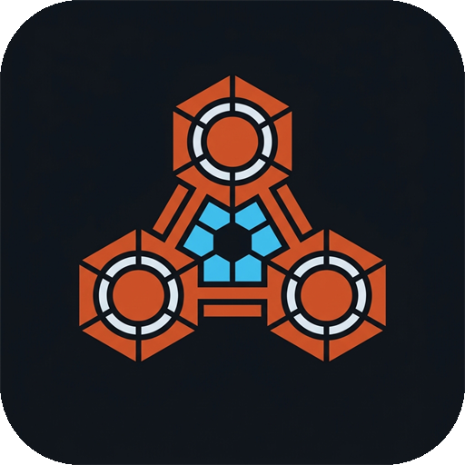
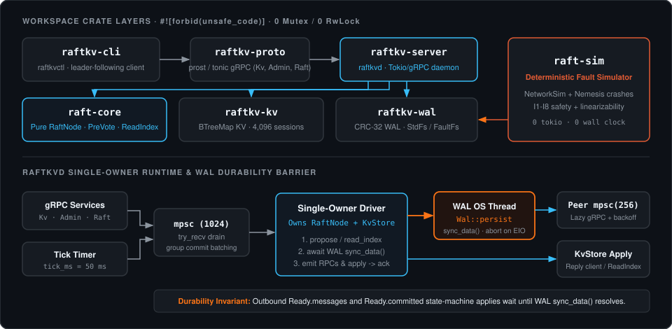
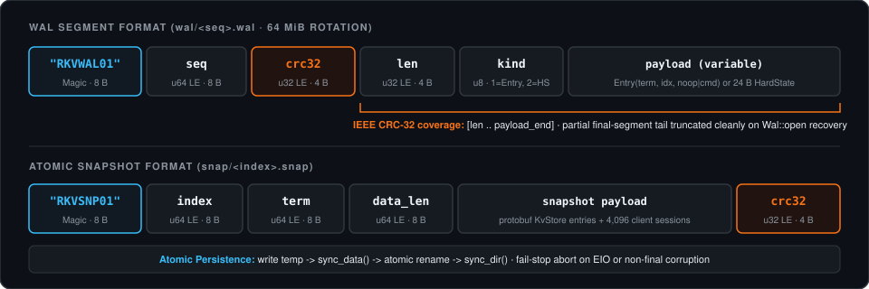
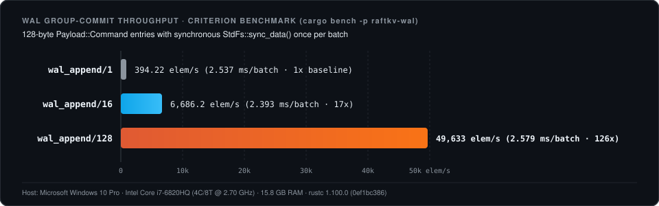

<div align="center">



<h1>raftkv</h1>

<p><strong>Deterministic Raft consensus engine and replicated key-value store in Rust</strong></p>

[](https://github.com/didrarayyan/Mini-etcd/actions/workflows/ci.yml)


[Overview](#overview) · [Quick Start](#quick-start) · [Architecture](#architecture) · [Guarantees](#protocol-guarantees) · [Simulation](#deterministic-simulation) · [Benchmarks](#benchmarks) · [Configuration](#configuration)

</div>

---

## Overview

`raftkv` implements a replicated key-value store backed by Raft consensus in Rust (`rustc 1.100.0`, Edition 2024). All protocol logic lives inside a synchronous, allocation-ordered state machine (`raft-core`) completely isolated from networking, clocks, disk I/O, and shared locks, allowing the exact same state-machine and storage code to run inside both a deterministic fault-injecting simulator (`raft-sim`) and multi-process gRPC servers (`raftkvd`).

> **Scope note:** `raftkv` is built as a systems engineering and portfolio project to verify Raft safety invariants, WAL durability barriers, and deterministic fault simulation from scratch. It is not intended as a drop-in replacement for etcd.

| Property | Implementation |
| --- | --- |
| **Memory & Type Safety** | `#![forbid(unsafe_code)]` enforced workspace-wide across all 7 crates |
| **Concurrency Model** | Single-owner actor driver (`0 Mutex`, `0 RwLock`); deterministic `BTreeMap`/`BTreeSet` in core |
| **Verified Test Suite** | `84` passing workspace tests (`72` unit/doc + `9` multi-process `SIGKILL` cluster tests + `14` sim scenarios) |
| **Fault Simulation** | `2,500` seeded runs (`11,685,586` total operations) under partitions, crashes, torn writes, and `EIO` |
| **Group-Commit WAL** | `49,633 elem/s` sustained append rate (`128`-entry batch with synchronous `sync_data()` per batch) |

## Architecture

`raftkv` splits pure protocol semantics from asynchronous execution: a single Tokio driver drains queued inputs into a group-commit `Ready`, persists snapshots, entries, and hard state synchronously on a dedicated OS WAL thread, and dispatches peer RPCs or client acknowledgements only after `sync_data()` resolves.

<p align="center">
  
</p>

- **`raft-core`**: Pure `RaftNode` state machine (`PreVote`, `CheckQuorum`, fast conflict-term backtracking, `ReadIndex`, snapshot compaction), verified free of `tokio`, `tonic`, clocks, or unordered maps via `cargo tree`.
- **`raftkv-kv`**: Deterministic ordered `BTreeMap<Bytes, Bytes>` supporting `Put`, `Delete`, `Cas`, and `[start, end)` `Range`, plus a 4,096-entry client deduplication session table.
- **`raftkv-wal`**: CRC-32 segmented WAL (`wal/<seq>.wal`) and atomic snapshot store (`snap/<index>.snap`) abstracted over `Fs` (`StdFs` in production, torn-write/`EIO` `FaultFs` in simulation).
- **`raftkv-proto`**: Protobuf and tonic gRPC service definitions (`Kv`, `Admin`, `Raft`) compiled with `protoc-bin-vendored`.
- **`raftkv-server` (`raftkvd`)**: Exclusive `<data_dir>/LOCK`, WAL thread (`std::process::abort()` on `WalError`), bounded `mpsc` backpressure, and `x-raftkv-leader-addr` redirect hints.
- **`raftkv-cli` (`raftkvctl`)**: Leader-following client reusing `(client_id, request_id)` across retries, plus concurrent `status_all` and `health` CLI checks.

## Protocol Guarantees

- **Election Safety & Partition Resilience**: Single leader per term with `PreVote` enabled so partitioned followers do not inflate cluster terms, paired with `CheckQuorum` so minority-isolated leaders step down automatically.
- **Durability Ordering**: Outbound `Ready::messages` and committed applies wait for `Wal::persist` + `sync_data()` before network dispatch or client acknowledgement; recovery truncates partial final-segment tails while failing fast on non-final corruption.
- **Linearizable Reads & Bounded Sessions**: Non-stale `get` and `range` confirm leadership via a quorum `ReadIndex` round and block until `applied_index >= read_state.index` (`--stale` serves locally). `KvStore` retains up to `MAX_SESSIONS = 4096` latest client sessions ordered by `(applied_index, client_id)` and rejects evicted older sequence IDs with `INVALID_ARGUMENT`.

<p align="center">
  
</p>

## Deterministic Simulation

| Layer | Technique | Crate | Verified Property |
| --- | --- | --- | --- |
| Log structure | `proptest` reference model | `raft-core` | Log truncation, slicing, and snapshot compaction match reference `Vec` |
| Protocol rules | Named unit + doc tests | `raft-core` | `PreVote`, `CheckQuorum`, Figure 8 commit rule, `ReadIndex`, snapshots |
| Codec integrity | `proptest` round-trips | `raftkv-kv`, `raftkv-wal`, `raftkv-server` | Encode/decode identity across commands, WAL records, and RPCs |
| Crash recovery | Exhaustive offset testing | `raftkv-wal` | Every-offset truncation, bit flips on `FaultFs`, and `EIO` poisoning |
| Cluster safety | Discrete simulation | `raft-sim` | Invariants `I1`-`I8` verified across network partitions, drops, and crashes |
| Client semantics | Linearizability checker | `raft-sim` | Concurrent `Put`/`Cas`/`Get` retries remain single-register linearizable |
| Reproducibility | Cross-run trace hashing | `raft-sim` | Identical seed produces bit-identical trace hash |
| Process recovery | Multi-process `SIGKILL` tests | `raftkv-server` | Real loopback gRPC failover, log/snapshot catchup, and CAS contention |

Simulation and process testing uncovered two real consensus edge cases that are now covered by regression tests:
1. **`PreVote` higher-term livelock (seed `146`)**: `handle_pre_vote` checked `proposed_term >= self.term`, blocking a longer-log lower-term node from winning pre-votes; fixed and locked by `prevote_succeeds_when_voter_has_higher_term_but_older_log`.
2. **`Replicate` idle heartbeat gap**: `bcast_heartbeat` skipped `send_append` for peers in `ProgressState::Replicate` whose `match_index` lagged while no new client writes arrived; caught by `follower_kill_and_rejoin_log_catchup` and locked by `replicate_follower_catches_up_via_heartbeat_without_new_proposals`.

```bash
# Reproduce any seed deterministically and verify release sweeps:
cargo run -p raft-sim --release -- --seed 146 --nodes 3

$ cargo run -p raft-sim --release -- --seeds 0..2000 --nodes 3
PASS: 2000 seeds (0..2000), nodes=3, ticks=20000, total_ops=10437539

$ cargo run -p raft-sim --release -- --seeds 0..500 --nodes 5
PASS: 500 seeds (0..500), nodes=5, ticks=20000, total_ops=1248047
```

## Quick Start

Requires Rust `1.100.0` (pinned in [rust-toolchain.toml](rust-toolchain.toml)). Start a local 3-node cluster with [scripts/dev-cluster.sh](scripts/dev-cluster.sh) or invoke `raftkvd --config <path>` directly:

```bash
cargo build --release -p raftkv-server -p raftkv-cli
./scripts/dev-cluster.sh
```

Recorded session against a live 3-node release cluster (`127.0.0.1:7001,127.0.0.1:7002,127.0.0.1:7003`):

```text
$ raftkvctl status
ENDPOINT               NODE   ROLE           TERM   LEADER   COMMIT   APPLIED  SNAP     LAST_LOG
127.0.0.1:7001         1      follower       1      2        0        0        0        1
127.0.0.1:7002         2      leader         1      2        1        1        0        1
127.0.0.1:7003         3      follower       1      2        0        0        0        1

Leader 2 peer replication progress:
PEER     MATCH_INDEX  NEXT_INDEX   RECENTLY_ACTIVE
1        1            2            true
3        1            2            true

$ raftkvctl put cluster/name prod-east
OK log_index=2

$ raftkvctl get cluster/name
prod-east
applied_index=2

$ raftkvctl cas cluster/epoch --absent 1
swapped=true current=1 log_index=3

$ raftkvctl range --prefix cluster/
KEY                      VALUE
cluster/epoch            1
cluster/name             prod-east
count=2 more=false applied_index=3

# After terminating leader node 2 and waiting for Term 2 election:
$ raftkvctl status
ENDPOINT               NODE   ROLE           TERM   LEADER   COMMIT   APPLIED  SNAP     LAST_LOG
127.0.0.1:7001         1      follower       2      3        4        4        0        4
127.0.0.1:7002         ERROR: transport error
127.0.0.1:7003         3      leader         2      3        4        4        0        4

Leader 3 peer replication progress:
PEER     MATCH_INDEX  NEXT_INDEX   RECENTLY_ACTIVE
1        4            5            true
2        0            4            false

$ raftkvctl get cluster/name
prod-east
applied_index=4

$ raftkvctl health
healthy term=2 leader=3 reachable=2/3
```

## Benchmarks

<p align="center">
  
</p>

Measured with `cargo bench -p raftkv-wal` (128-byte `Payload::Command` entries, synchronous `StdFs::sync_data()` once per batch) on Microsoft Windows 10 Pro, Intel(R) Core(TM) i7-6820HQ CPU @ 2.70GHz (4 cores / 8 logical processors), 15.8 GB RAM, `rustc 1.100.0 (0ef1bc386 2026-11-09)`:

| Benchmark (`wal_append/<batch>`) | Time (`[low, est, high]`) | Throughput (`[low, est, high]`) |
| --- | --- | --- |
| `wal_append/1` | `[2.4291 ms, 2.5367 ms, 2.7147 ms]` | `[368.37 elem/s, 394.22 elem/s, 411.68 elem/s]` |
| `wal_append/16` | `[2.2609 ms, 2.3930 ms, 2.6106 ms]` | `[6.1289 Kelem/s, 6.6862 Kelem/s, 7.0768 Kelem/s]` |
| `wal_append/128` | `[2.4457 ms, 2.5789 ms, 2.7905 ms]` | `[45.870 Kelem/s, 49.633 Kelem/s, 52.336 Kelem/s]` |

## Configuration

`raftkvd --config <path>` validates strict TOML (`deny_unknown_fields`); runtime env vars are `RUST_LOG` (`info` default), `RAFTKV_ENDPOINTS` (`raftkvctl` fallback), and `SIM_SEEDS` (`200` default).

| Key | Default | Meaning |
| --- | --- | --- |
| `node_id`, `listen_addr`, `data_dir` | required | Non-zero node ID, gRPC bind socket, and `LOCK`/`wal`/`snap` directory |
| `cluster.peers` | required | 1-7 static voting `{ id, addr }` endpoints |
| `raft.tick_ms` / `election_ticks` / `heartbeat_ticks` | `50` / `10` / `2` | Logical tick interval (ms), randomized election timeout `[N, 2N)`, heartbeat |
| `raft.max_append_entries` / `max_append_bytes` | `64` / `1048576` | Entry count and soft byte cap per `AppendEntries` batch |
| `raft.snapshot_threshold` / `retain_entries` | `10000` / `1024` | Applied entries between compactions and WAL entries kept below snapshot |
| `limits.max_key_bytes` / `max_value_bytes` | `1024` / `1048576` | Ingress key/value bounds enforced before Raft proposal |
| `limits.max_snapshot_bytes` / `request_timeout_ms` | `1073741824` / `5000` | Max incoming snapshot stream bytes and client RPC deadline |

## Limitations

- **Static cluster membership**: Peer membership is fixed (1-7 nodes) at startup; dynamic `ConfChange` and multi-Raft sharding are omitted.
- **In-memory dataset & driver snapshotting**: Live data resides in a single `BTreeMap` serialized synchronously on the driver task at compaction time.
- **Plaintext gRPC**: Peer authentication checks `node_id` allowlists without TLS, mTLS, or bearer tokens.
- **Directory fsync portability**: `StdFs::sync_dir` calls `File::sync_all()` on Unix; native Windows validates directory metadata and relies on file-level `FlushFileBuffers` plus `<data_dir>/LOCK`.

## References and License

- Diego Ongaro and John Ousterhout, *In Search of an Understandable Consensus Algorithm (Extended Version)*, USENIX ATC 2014.
- Diego Ongaro, *Consensus: Bridging Theory and Practice*, PhD Dissertation, Stanford University, 2014 (Sections 4.2.3 and 9.6).
- Licensed under the MIT License; see [LICENSE](LICENSE).
